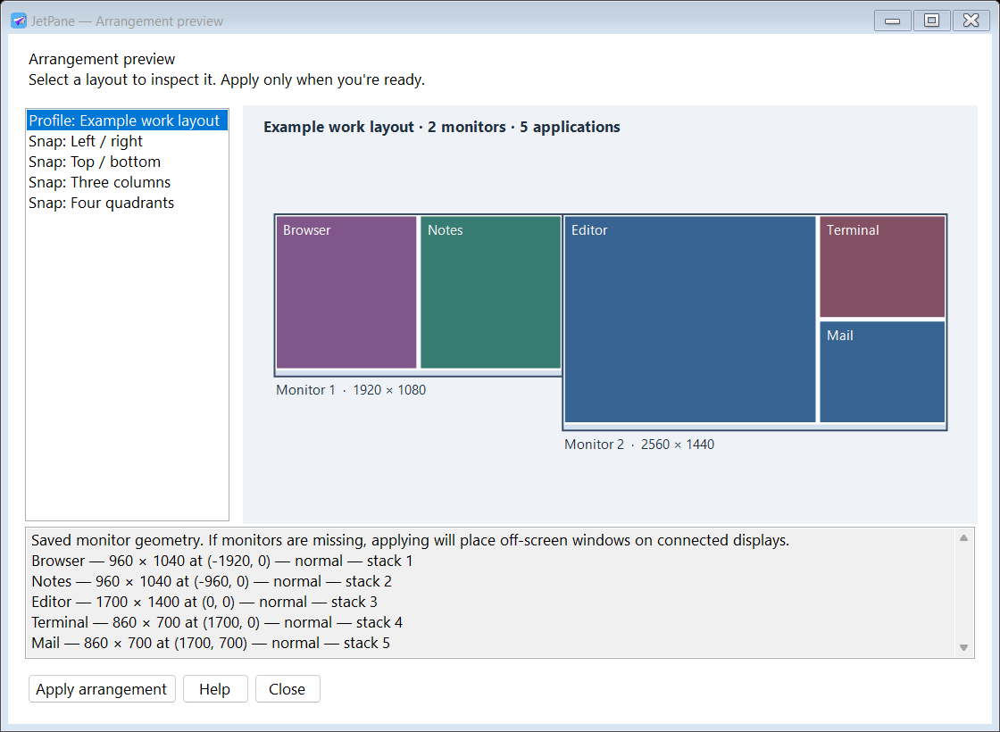
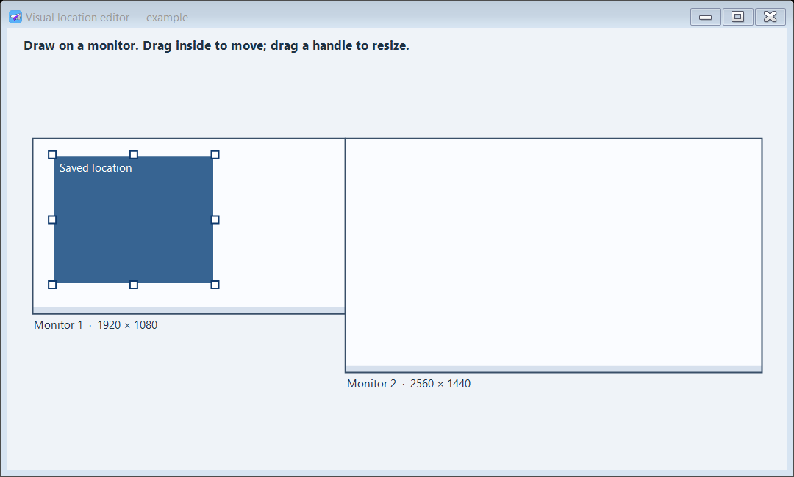

Published by **Atomic 22 Industries**.

<h1 align="center">Your windows. Ready for takeoff.</h1>

A portable Windows tray utility for saved desktop arrangements, visual placement regions, and keyboard control across multiple monitors.

<a href="https://github.com/dave-patrick/JetPane/releases/tag/v1.1.4">Download</a> · <a href="https://dave-patrick.github.io/JetPane/">Website</a> · <a href="docs/help.html">Complete offline help</a> · <a href="documentation/GETTING-STARTED.md">Getting started</a>

## Run it

Download `JetPane-portable.zip` from [Releases](https://github.com/dave-patrick/JetPane/releases), extract the entire archive into a writable folder, and run **JetPane.exe**. Windows x64. No installer, separate .NET installation, Microsoft Store, account, or subscription. The runtime is bundled; native runtime files may unpack into Windows’ temporary cache.

Right-click the tray icon for controls. Double-click it for Settings. Start with Windows is optional and initially disabled.

## Three ways to arrange a desktop

| Mode | What it does | Use it for |
| --- | --- | --- |
| Profiles | Save positions, sizes, states and stacking order across monitors; load a profile and launch missing apps | Workspaces, docking, different tasks |
| Snap layouts | Divide one monitor into halves, thirds or quadrants, with slot locks and automatic filling | Tiling apps while you work |
| Locations | Draw a named rectangle and assign a shortcut to move the active app there | Keyboard placement of individual windows |

Other controls include monitor assignments, custom hotkeys, automatic restore/save, separate exclusions, import/export, and an optional clean-desktop profile switch. The [full guide](docs/help.html) covers every option.

## See the arrangements

The diagram is an actual rendered application preview using a clearly labeled example layout, not a capture of private desktop contents. Selecting a preview does not rearrange windows; Apply is separate.

Draw a region, move it, resize its handles, or set exact pixel coordinates. Give it a name, assign a shortcut, then use it on the active application.

## Updates

Choose **Check for updates…** in the tray menu or Settings → About & help. Download the offered release, then choose **Restart and install**. Published prereleases are included. Checks run only on request; downloads are verified and the old app is backed up. Settings and profiles stay in place. Versions before 1.1.4 need one manual upgrade to get the updater.

## Default keys

| Shortcut | Action |
| --- | --- |
| Ctrl+Alt+S | Save current profile |
| Ctrl+Alt+R | Restore open windows |
| Ctrl+Alt+P | Open arrangement previews |
| Ctrl+Alt+1–9 | Profile numbers, when assigned |

Edit these in **Settings → Keyboard shortcuts**. Snap and location shortcuts start unassigned. Duplicate combinations are rejected and Windows registration conflicts are reported. All global shortcuts can be disabled for AltGr compatibility.

## Status and boundaries

This is an early independent implementation, not recovered PositionPro code or a compatibility clone. **89 local checks** passed, including Win32 positioning on two attached monitors, geometry, shortcut validation and settings persistence; a tray/event-loop smoke test passed. Evidence is in [tests/evidence](tests/evidence). Physical dock/undock, login startup, real editor gestures, and every third-party app/shortcut combination still require broader validation.

- One saved window per **process name**; multiple windows of one app are not independently tracked in profiles.
- Explorer, ApplicationFrameHost, utility/cloaked windows and normal windows smaller than 400×300 are excluded from automatic management.
- Elevated applications can reject movement; application minimum sizes or self-positioning can override placement.
- One active snap layout on one target monitor; profiles can span all connected displays.
- Executable paths are saved, but documents and launch arguments are not restored.
- Display changes are polled, not claimed to use PositionPro’s internal hooks. Screens with identical geometry share a signature.
- `.wpilot` exports remain compatible with the earlier WindowPilot name. PositionPro `.ppro` files are not supported.

## Repository guide

| Folder | Contents |
| --- | --- |
| `src/JetPane` | Maintained C# WinForms app, icon, manifest and shipped help |
| `docs` | Buildless landing page, help, demo and screenshots; GitHub Pages source |
| `documentation` | Setup, build, architecture, release, privacy and branding notes |
| `assets/brand` | Approved final wordmark and standalone icon |
| `assets/design-archive` | Earlier icon and typography explorations, not approved production branding |
| `scripts` | Repeatable portable packaging and site checks |
| `.github/workflows` | Windows build and GitHub Pages deployment |

Build with `pwsh ./scripts/build.ps1`. The [.NET 10 SDK](https://dotnet.microsoft.com/download/dotnet/10.0) is needed to build, not to run the portable download. See [BUILDING](documentation/BUILDING.md).

## Data, license and contributions

Settings, backups and optional errors remain beside the executable. No telemetry. Manual update checks and downloads contact GitHub. Never commit personal settings or logs. Read [PRIVACY](documentation/PRIVACY.md), [CONTRIBUTING](CONTRIBUTING.md), and [SECURITY](SECURITY.md).

The repository’s original [MIT license](LICENSE) is preserved. The public PositionPro descriptions informed the initial feature specification; JetPane is independently implemented and unaffiliated.
